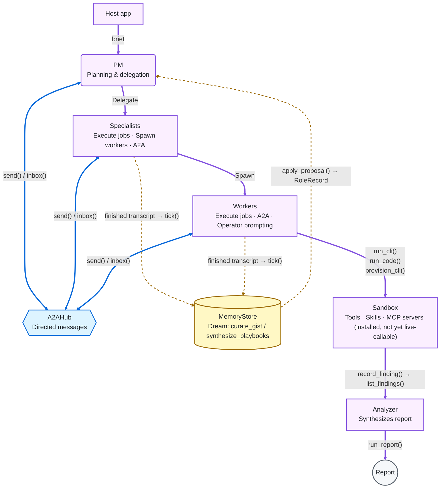

# orchestrator

A reusable, domain-agnostic agent runtime that **plans → executes → recovers → grows** — single-agent by default, with an optional multi-agent **brain** (named roles, directed agent-to-agent messaging, and a Dream cycle that turns finished runs into reusable playbooks).

## Install

Plug-and-play — this repo is a real, pip-installable package (`pyproject.toml`, `src/` layout):

```bash
pip install git+https://github.com/Salto7/Agent-runtime.git
# or, working from a clone:
pip install -e .
```

That's the whole integration cost. Nothing else is required to `import orchestrator` — no config file, no running service, no API key needed just to construct an `Orchestrator()` or any of the `brain`/`mcp`/`marketplace` classes. An LLM provider key (see `.env.example`) is only needed once you actually call `plan()`/`run()` or the brain's LLM-backed `tick()`.

```python
from orchestrator import Orchestrator

orch = Orchestrator()
orch.plan("fetch https://example.com and summarize its headers")
orch.run("fetch https://example.com and summarize its headers", plan_first=True, remove_sandbox=True)
```

## Overview

Orchestrator runs tools and custom Python scripts from a tool catalog or skill asset in isolated sandboxes, so each run stays cheap and repeatable. Skills and tools live as files under `skills/` and `tools/catalog/` — extending the system is adding files, not writing new runtime code. Your app implements `AgentPorts` for events, subagents, and findings.

**Skills format:** skill directories follow the open [Agent Skills](https://agentskills.io) (`agentskills`) `SKILL.md` layout (YAML frontmatter + Markdown body, optional `scripts/` / `references/` / `assets/`). Orchestrator extends that with product fields under `metadata:` (category, jobable, lifecycle, requires_clis, …) and standardized `scripts/run.py` entrypoints.

## How it works

A prompt becomes a plan, a sandbox is provisioned with whatever the plan needs, and an agent loop executes it — looping back through a **replan** step on failure instead of just giving up. An Analyzer step always runs at the end and drafts a markdown report from findings. After a run, the host can call `suggest_skills` with the brief or findings to recommend what to run next.

```text
prompt → plan → sandbox → provision → execute ⇄ replan → result → suggest next skills
```

Underneath, that loop is a small, plain-Python state machine (`orchestrator.agent.graph`, no graph-execution framework) with four steps: **`gate`** (drains any live operator guidance before each turn), **`agent`** (one LLM turn — think, or call a tool), **`tools`** (runs the requested tool), and **`recover`** (a tool result that looks like an error gets a recovery nudge injected back into the conversation, instead of the loop silently repeating the same failing call — bounded by `AGENT_MAX_FAILURE_REPLANS`, with the whole loop bounded by `AGENT_MAX_ITERATIONS`). Every job in the multi-agent diagram below — PM, specialist, or worker — runs this exact same graph; see "Adding a tool, skill, or role" for how a role changes what it does without changing this loop.

## Core features

| Feature | Description |
|---|---|
| **Replanning, not just retrying** | A failed tool call injects a targeted recovery nudge (see graph above) rather than blindly repeating the same call; both the per-failure and total iteration counts are capped. |
| **Prompting with cost visibility** | `orchestrator.utils.llm.chat_text` / `chat_json` is the whole LLM facade (LiteLLM underneath — swap providers via env, no code change). Wrap any call in `orchestrator.utils.llm_usage.purpose("...")` to tag it for cost/token reporting. |
| **Add tools or skills easily** | Draft new skills and tools from a single prompt, or add them as files — see "Adding a tool, skill, or role" below. |
| **Suggest next skills** | Pass the brief or findings to `suggest_skills` after a run. |
| **Flexible installs** | Install recipes: `apt`, `github_release`, `git_clone`, `pip`, or `custom` bash script. Tool install priority: catalog → skill-provided install docs → LLM-planned fallback. |
| **Tested tool installs** | Validate each new recipe in a learn-lab sandbox before it's used for real. |
| **Live streaming** | Unix **stream** + **RPC** servers (`StreamSocketServer`, `RpcServer`); skill helpers in `skills/helpers/orchestrator_tools.py` are the matching clients, for custom tools to stream live progress to a host UI. |
| **Extend as data** | Add a skill or catalog YAML with no code changes. |
| **Safe learning** | Draft new tools or skills, lab-test, then approve for use — nothing self-modifies silently. |

**API surface:** `plan()` / `run()` / `suggest_skills()` · `provision_cli` cascade (catalog → skill `INSTALL.md` → LLM) · failure nudges + `drain_operator_guidance()` · Learn (`suggest_tool` / `write_skill` / `LearnLab`) · skill runners + stream/RPC sockets.

## Multi-agent brain: roles, A2A, and Dream

`orchestrator.brain` adds what a *multi*-agent host needs on top of the single-agent runtime above: named **roles** a job can run as (the CrewAI-style idea of "this run is the researcher, that run is the reviewer"), **directed** agent-to-agent messages between live jobs, and a **Dream** cycle that turns finished runs into lessons, consolidates them into playbooks, and proposes role changes — reviewed by a human before anything goes live.

Storage-agnostic by design: all four pieces talk only to small protocols (`RoleStore`, `MessageStore`, `MemoryStore`, `ProposalStore` in `orchestrator.brain.protocols`). `orchestrator.brain.memory_backend` ships an in-process reference implementation of each, so the brain works with nothing but Python installed; a host swaps in its own (a database, an existing ORM, anything) without the brain's logic changing.

```python
from orchestrator.brain import A2AHub, RoleRegistry, RoleRecord, tick
from orchestrator.brain.memory_backend import InMemoryMemoryStore, InMemoryProposalStore, InMemoryRoleStore
from orchestrator.utils.llm import chat_json

# Roles — who an agent is this run
roles = InMemoryRoleStore()
roles.upsert_role(RoleRecord(role_id="researcher", goal="gather and summarize sources"))
roles.upsert_role(RoleRecord(role_id="reviewer", goal="check a researcher's draft for gaps"))
registry = RoleRegistry(store=roles)

# A2A — directed messages between live jobs, never a broadcast
hub = A2AHub()
hub.send(sender_job_id="pm-1", recipient_job_id="researcher-1", kind="request", content="start the brief")

# Dream — periodically (your own scheduler calls this; the library starts no threads)
result = tick(
    roles=roles,
    memory=InMemoryMemoryStore(),
    proposals=InMemoryProposalStore(),
    chat_json=chat_json,
    finished_runs=[("researcher-1", "researcher", transcript_text)],
)
```

- **Roles never go live without review.** Dream's role suggestions land as pending `ProposalRecord`s; `orchestrator.brain.dream.apply_proposal(roles, proposals, proposal_id, decision="approve")` is the only path from a proposal to a real `RoleRecord`, and a `protected` role refuses the kind of change that would replace its identity.
- **A2A has real limits, not just a happy path.** `A2AHub.send`/`multisend` raise on self-messaging, on a per-pair message cap (stops two agents looping each other), and on exceeding `max_recipients` — failures are reported per-recipient, not as one all-or-nothing error.
- **"Resume a finished agent" is a host hook, not an assumption.** `send(..., wake=your_callback)` fires your callback with the recipient's job id; the brain has no opinion on how your runtime actually resumes a job.
- **`RoleRegistry` tracks skill changes, not just role edits** — `unbound_skills()` returns skills nothing is bound to yet, which is exactly what Dream's role proposals act on as your skill catalog grows.
- **Dreaming is consolidation, not just logging.** `render_gist` turns one finished run into a lesson; `synthesize_playbooks` periodically merges many lessons of the same kind into a reusable playbook, so the Nth run of a role benefits from the first N-1.

### Putting it together: a PM, specialists, and workers over one run

The piece that's easy to miss from the sections above in isolation: a PM job, specialist jobs, and worker jobs are not three different kinds of code — they're the same agent graph running under three different `RoleRecord`s, coordinated only through A2A, with the sandbox/MCP/tools layer underneath each one and the brain watching from outside the live run entirely.



- **PM → A2A → specialists/workers.** The PM never calls another job directly — only through `A2AHub.send()`/`multisend()`, with built-in per-pair and fan-out limits; delivery is pull-based via `inbox()`. "Specialists" and "workers" stand in for any number of jobs — in a real run there can be many of either.
- **Every box is the same agent loop.** PM, specialists, and workers all run the identical gate → act ⇄ tools/recover loop from "How it works" above — only the role (goal/skills/prompt) differs. "Specialist" and "worker" aren't special-cased types in the code, just different roles.
- **Tool execution is real; MCP execution isn't, yet.** `run_cli()`/`run_code()`/`provision_cli()` are live calls a job's tool-binding actually makes. `orchestrator.mcp.McpInstaller.install_source()` registers an MCP server into a catalog — a separate, install-time action — but nothing in this repo currently binds an installed MCP server as a callable tool inside a live run. Hosts wiring MCP execution in need to add that binding themselves.
- **Analyzer only sees the end state.** It runs once, after the PM has marked every objective done (or the run ends), and synthesizes the final report from accumulated findings (`list_findings()`) — it is not part of the A2A delegation chain.
- **Brain runs out-of-band.** Dream doesn't touch a live run at all — the host collects finished transcripts and periodically calls `tick()`; the only thing that ever reaches a future run is an *approved* role change (`apply_proposal()`) updating that role's `RoleRecord`.

## MCP servers & Marketplace

`orchestrator.mcp` installs stdio [MCP](https://modelcontextprotocol.io) servers — from a local folder, a git repo, or an npx package — into a host-provided `McpStore`. `orchestrator.marketplace` fetches and *read-only* scans an external repo or zip for skill packs, agent configs, and MCP pointers, so a host can stage findings for review before anything is imported.

```python
from pathlib import Path
from orchestrator.mcp import InMemoryMcpStore, McpInstaller
from orchestrator.marketplace import fetch_git, scan_all

# Install a stdio MCP server from a git repo (disk and npx work the same way)
installer = McpInstaller(store=InMemoryMcpStore(), mcps_dir=Path("mcps"))
installer.install_source("git", "owner/some-mcp-server")

# Browse a marketplace repo before importing anything from it — nothing here
# is executed or imported, only read
repo = fetch_git(Path("workspaces/marketplace"), "source-1", "owner/skills-pack")
found = scan_all(repo)  # {"skills": [...], "agents": [...], "mcp_pointers": [...]}
```

- **stdio only, sandbox PATH only.** The parser rejects `sse`/`http` transports and any command that looks like a host filesystem path (`/usr/bin/...`) — only a bare executable the sandbox already has (`python`, `node`, `npx`, `uv`, …).
- **Secret values never land in the catalog.** A document with a literal token/password/API key in it is rejected outright; only env var *names* are stored as a schema, with values supplied by the caller at run time.
- **A clone directory's name is never trusted.** `git clone` always lands at `.../repo` — `McpInstaller` derives the real id from the repo URL (or the package's own `name`), not the throwaway folder name.
- **Marketplace scanning stages, it doesn't install.** `scan_all` only reads files as text/JSON/YAML; turning a finding into a live skill, role, or MCP server is a separate, explicit step the host controls.

## Adding a tool, skill, or role

Everything below is adding a file — no runtime code changes needed.

**A tool** — drop a YAML file in `tools/catalog/`:

```yaml
# tools/catalog/mytool.yaml
id: mytool
name: mytool
description: What mytool does, in one line.
tier: catalog
binary: mytool
binaries: [mytool]
install:
  - type: apt          # or github_release / git_clone / pip / custom
    packages: [mytool]
verify:
  - command: mytool --version
tags: [cli]
```
Validate it with `python examples/thin_client.py test-tool tools/catalog/mytool.yaml` (runs the install + verify steps in a learn-lab sandbox before anything production-facing uses it).

**A skill** — drop a directory with a `SKILL.md` in `skills/`:

```markdown
---
name: my-skill
description: One line — when an agent should use this skill.
compatibility: Requires mytool
allowed-tools: sandbox_setup run_skill_script skills_list skill_view
metadata:
  version: 1.0.0
  category: data
  jobable: 'true'
  lifecycle: short
---

## Goal
What this skill does and how `scripts/run.py` is invoked.
```
Lint it with `python examples/thin_client.py lint-skill my-skill` (checks frontmatter, name/dir match, and body references match `SkillLinter`'s rules). Or skip authoring by hand entirely: `LearnAuthoring.write_skill("fetch a URL and summarize its headers")` drafts both the skill and, if needed, a matching tool recipe.

**A role** — for the multi-agent brain, no file needed, just a store write:

```python
from orchestrator.brain.protocols import RoleRecord
roles.upsert_role(RoleRecord(role_id="reviewer", goal="check a draft for gaps", protected=False))
```
A `protected=True` role can't be overwritten by an auto-approved Dream proposal — reserve that for roles whose identity must never silently drift.

## Usage

Use `examples/thin_client.py` (one-shot or interactive):

```bash
pip install -e . && cp .env.example .env   # set OPENROUTER_API_KEY

python examples/thin_client.py plan "fetch https://example.com and extract the title"
python examples/thin_client.py suggest-tools "add a yq fuzzer for YAML diffing"
python examples/thin_client.py draft-skill "fetch a URL and summarize its headers"
python examples/thin_client.py run "fetch https://example.com and extract the title" --plan-first --remove
python examples/thin_client.py list-skills
python examples/thin_client.py list-tools
python examples/thin_client.py lint-skill my-skill
python examples/thin_client.py test-tool tools/catalog/jq.yaml
```

Docker is required for `run` / Learn lab / `provision_cli`. Env: see `.env.example`. Layout: `src/orchestrator/{agent,tools,runtime,skills,learn,brain,mcp,marketplace}` · sample `skills/` · `tools/catalog/`.
